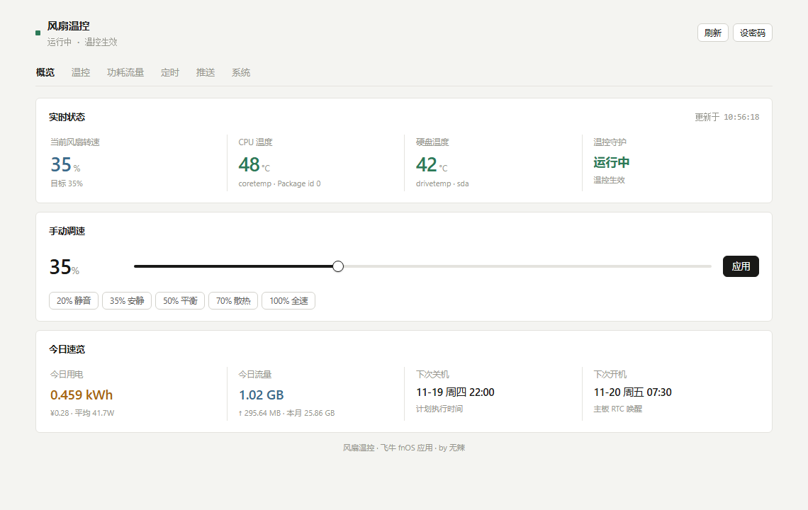
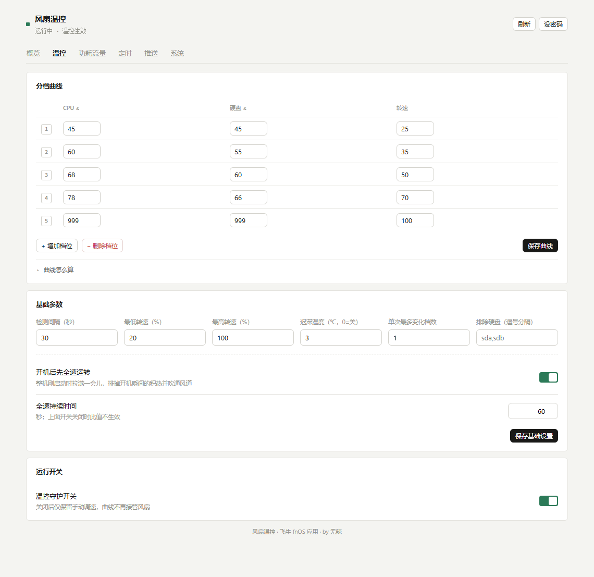
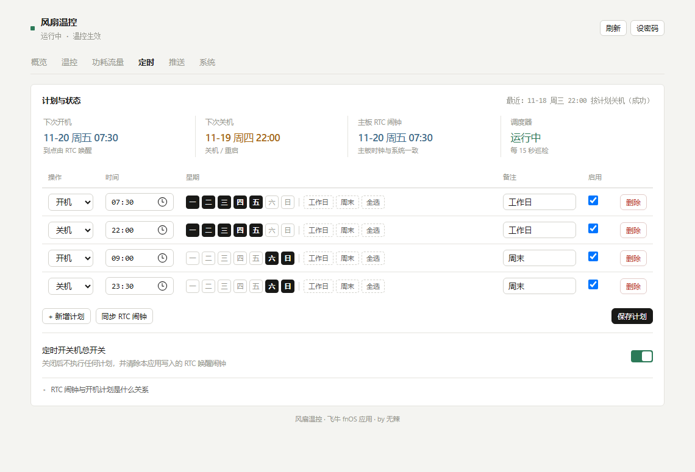
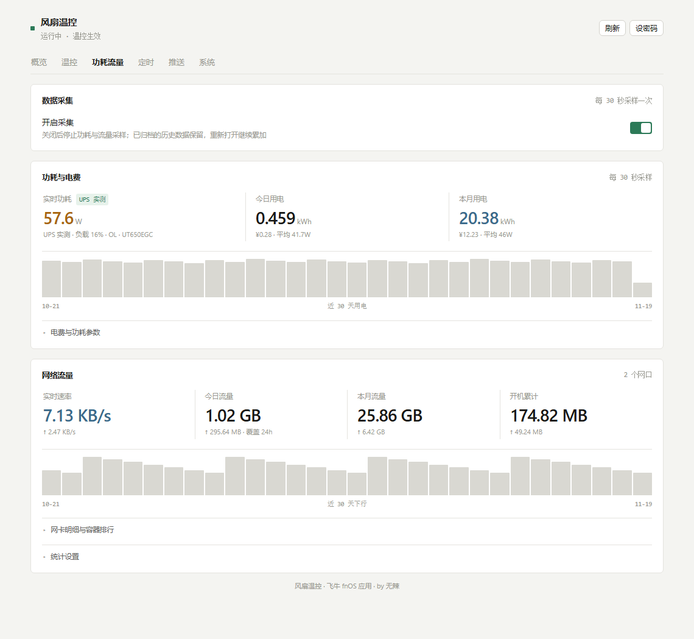
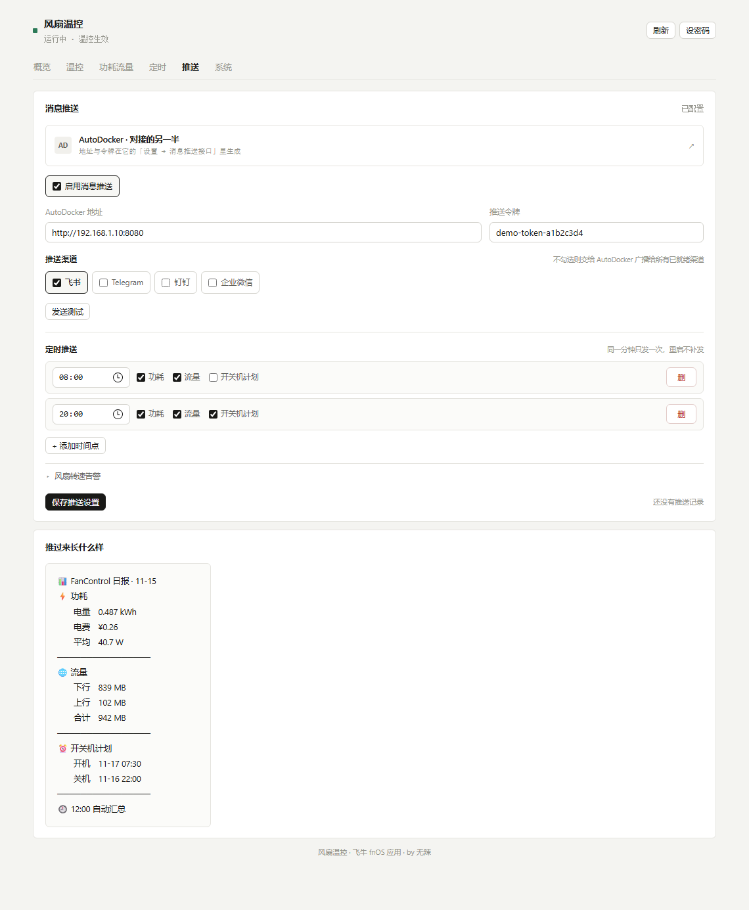
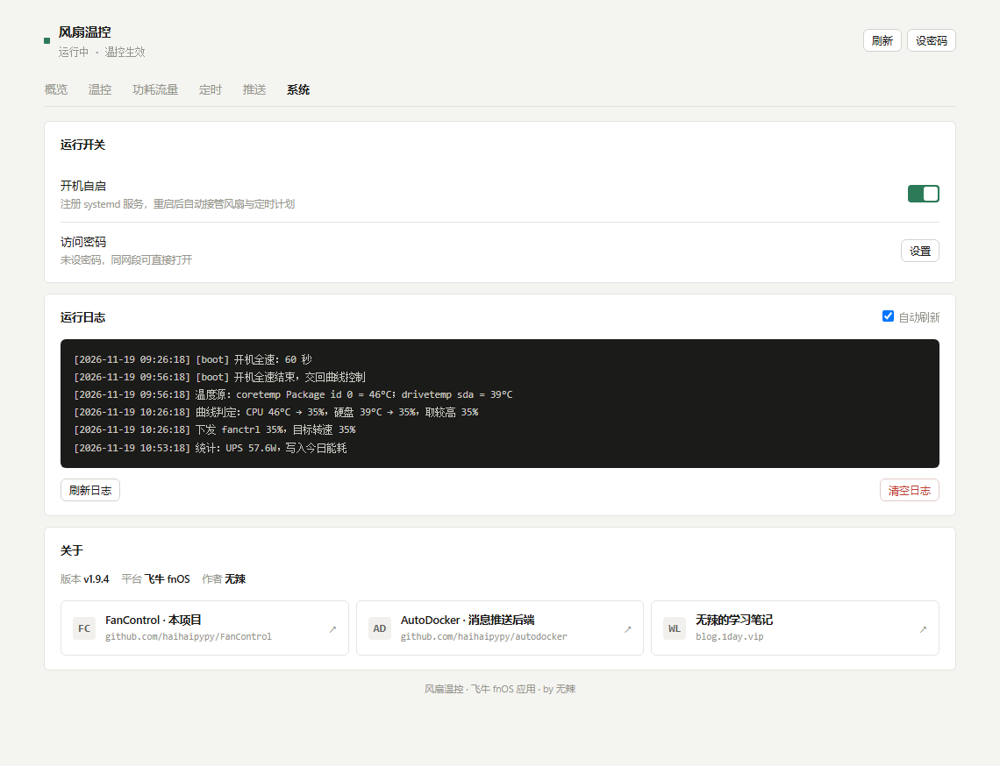

# 风扇温控 + 定时开关机 · 飞牛 fnOS 应用

一个飞牛 fnOS 应用（`.fpk`），把原来只能 SSH 敲命令的 `fan_control.sh` 换成**能点的可视化页面**，并补上了 fnOS 本身缺的**定时开关机**。

装进飞牛应用中心，桌面点图标就开。温控、统计、电源计划、消息推送分在六个页签里：看着实时温度拖滑块、按曲线让风扇自己跑、开机先满速吹一遍、按星期排好开关机时间点，全程不用开终端、不用记命令。



| 项 | 值 |
|---|---|
| 平台 | x86_64（飞牛 fnOS，`os_min_version` 0.9.0） |
| 实测机型 | 拾光坞 G2（Intel N150，3 盘位） |
| 访问 | `http://<NAS-IP>:7300`，局域网直连 + 登录密码（可关闭） |
| 密码 | **可选**。安装向导里留空 = 不设密码；页面「改密码」可改，新密码留空 = 取消密码 |
| 权限 | root（调风扇、写 RTC、注册 systemd 服务） |

> [!WARNING]
> **兼容性声明：仅在作者的拾光坞 G2 上实测过，不保证其他设备可用。**
>
> 本应用的硬件依赖比一般软件重：风扇控制走的是 `fanctrl` 二进制直接操作 EC / PWM 通道，温度采集依赖具体主板暴露的 hwmon 传感器，定时开机依赖主板 RTC 能否接受 `wakealarm` 写入。这些在不同品牌的 NAS / 小主机上差异极大，**同一份代码在别的机器上很可能读不到风扇、读不到温度，或者读到的温度是假值**。
>
> 因此：**装之前请自行评估风险**。可能出现的情况包括但不限于 —— 风扇转速无法控制、被设成固定值后不随温度变化（有**过热风险**）、温度读数错误导致该转的时候不转、定时开机到点不启动。
>
> 建议先在**不重要的机器或非关键时段**试装，观察日志和实际风扇声再决定是否长期使用。**卸载脚本会把风扇恢复到 35%**，真出问题可以先卸载退出。
>
> 如果你在别的机型上跑通了，欢迎在 Issues 里贴一下**机型 + 温度来源（页面卡片下的小字）+ 风扇控制是否正常**，我把它补进兼容性列表。

---

## 功能

### 〇、页面怎么分（v1.9.0 起）

v1.7.0 之前所有卡片摊在一页，加一次功能就长一截，找东西要滚半天。现在按功能拆成六个页签：

| 页签 | 放什么 |
|---|---|
| **概览** | 实时状态（转速 / CPU / 硬盘 / 守护）、手动调速、今日速览 |
| **温控** | 分档曲线、检测间隔、迟滞与档位、开机全速、温控守护开关 |
| **功耗流量** | 采集总开关；功耗与电费（实时功率、今日 / 本月电费、30 天柱状图、电价与分时电价）；网络流量（实时速率、今日 / 本月 / 开机累计、30 天柱状图、网卡明细、容器排行）；各自一块 CSV 导出 |
| **定时** | 开关机计划表、下次开关机、RTC 闹钟、总开关 |
| **推送** | AutoDocker 地址与令牌、渠道勾选、定时点（直接展开）、转速告警、文案样式预览 |
| **系统** | 开机自启、访问密码、运行日志、版本号与项目链接 |

三个细节：

- **地址栏会带 `#/stats` 这样的 hash**，刷新页面、加书签、从浏览器历史前进后退都停在同一页，不会跳回概览。v1.8.0 留下的 `#/power`、`#/traffic` 会自动落到「功耗流量」，老书签不会失效。
- **采集开关只有一个**，在「功耗流量」页最上面，控制 `metrics.enabled`。关掉就停止功耗与流量采样（已归档数据保留），功耗和流量一起停 —— 两者本来就是同一个采样线程，分开开关会让人以为关了一半。
- **控件跟着功能走**：开机自启和访问密码属于应用本身，收进「系统」；温控相关的几个参数合到「温控」一张卡里，改完点一次「保存基础设置」。

概览页的「今日速览」是给日常看的：今日用电与电费、今日流量、下次关机与下次开机。
每次打开页面第一眼就能确认「昨天电费多少、机器今晚几点关」，不用逐个页签翻。

### 一、风扇温控

| 功能 | 说明 |
|---|---|
| **实时状态面板** | 当前转速、CPU 温度、硬盘温度、守护进程状态，3 秒自动刷新；两张温度卡片下方实时标注**取值来源**（哪个传感器），出问题一眼能定位 |
| **手动调速** | 滑块 + 五个快捷档（20 / 35 / 50 / 70 / 100%），直接下发 `fanctrl`，随时手动接管 |
| **分档温控曲线** | CPU 与硬盘**各自查表后取较高转速**（谁热听谁的），分档表格在页面直接改，保存即生效，不用重启 |
| **平滑策略** | 迟滞 3℃ + 单次最多变 1 档 + 紧急直通（CPU≥90℃ / 硬盘≥70℃ 直接满速），消除温度骑在分界线上反复翻档、以及尖峰把风扇一把拉满 |
| **基础参数** | 检测间隔、最低 / 最高转速、排除指定硬盘、迟滞与渐变档数（填 0 可关闭） |
| **开机全速** | 整机启动后先满速吹一段（默认 60 秒，可关可改时长），排掉开机瞬间积热 |



### 二、定时开关机

| 功能 | 说明 |
|---|---|
| **计划表** | 开机 / 关机 / 重启三种动作，按星期组合（不选星期 = 每天），一个页面管完 |
| **定时开机** | 把下次唤醒时间写进**主板 RTC 闹钟**（`/sys/class/rtc/rtcN/wakealarm`）—— 关机状态下只有硬件能叫醒；自动补偿主板时钟与系统时间的时区偏差 |
| **安全兜底** | 关机 / 重启前强制重写一次 RTC，确保这次关机一定能被叫醒；同一分钟只执行一次，关机优先于重启；没有开机计划时打警告日志 |
| **状态可视** | 下次开机、下次关机、RTC 闹钟、调度器运行状态四张卡片 |



> ⚠️ 定时开机**需要 BIOS 里开启「Resume by RTC Alarm / 定时唤醒」**，软件层面无解。详见下文「定时开关机」一节。

### 三、功耗与流量（v1.6.0 起）

| 功能 | 说明 |
|---|---|
| **功耗与电费** | 实时整机功耗（**优先 UPS 实测**，其次 RAPL，最后模型估算）、今日 / 本月用电量与电费、近 30 天柱状图、CSV 导出 |
| **UPS 功率** | 直读 NUT（`127.0.0.1:3493` 或远程 NAS），只读、不接管；取的是插座级整机功率，含硬盘与电源损耗 |
| **分时电价** | 峰谷电价按时段配置（最多 12 段，可跨零点），未覆盖时段走基础电价；按小时桶计价，天然对齐时段边界 |
| **网络流量** | 实时速率、今日 / 本月流量、开机累计、近 30 天柱状图、逐网卡明细；可选容器流量排行 |
| **一个开关** | 「基础设置 → 流量与功耗统计」，关掉即停止采样（已归档数据仍保留），不必卸载 |



### 四、消息推送（v1.7.0 起）

| 功能 | 说明 |
|---|---|
| **定时推送** | 可加多个时间点，每个点自己选带「前一天功耗 + 电费」「前一天流量」「下次开关机时间」，到点合成一条日报发出去 |
| **转速告警** | 转速达到阈值（默认 80%）推一条，含当前转速与 CPU / 硬盘温度；开机全速那一段不判，冷却期内不重复发 |
| **渠道勾选** | 飞书 / Telegram / 钉钉 / 企业微信，不勾 = 交给 AutoDocker 发给所有已就绪渠道 |
| **发送测试** | 填完地址和令牌先发一条验证，不用先保存 |



推到手机上长这样（飞书）：


### 五、运维

| 功能 | 说明 |
|---|---|
| **日志查看** | 页面内看日志尾部，支持自动刷新与清空 |
| **开机自启** | 一键注册 systemd 服务，重启后自动接管；守护进程带单例锁，不会出现两个进程抢风扇 |
| **访问控制** | 局域网直连，登录密码保护；页面可改密码，也可留空取消密码（免登录）；重新设密码立即生效 |
| **接管旧脚本** | 安装时可选停掉旧的 `fan_control.service` 并结束 `fan_control.sh`；卸载时恢复风扇到 35% |



## 温度传感器怎么选（v1.2.0 起）

**读到了值 ≠ 读对了传感器。** 这是整套方案最容易出错的地方 —— 页面上两张温度卡片的**下方小字会实时显示当前取值来源**，日志开头也会打印一行探测结果。

| 温度 | 优先级 | 选取规则 |
|---|---|---|
| **CPU** | 1. hwmon `coretemp` / `k10temp` / `zenpower` | **按 `tempN_label` 匹配**（Intel 找 `Package id 0`，AMD 找 `Tctl` / `Tdie`），**不按 `tempN` 序号** |
| | 2. `/sys/class/thermal/thermal_zone*` | **明确跳过 `acpitz`** |
| | 3. `sensors` 命令 | 取最大值兜底 |
| **硬盘** | 1. hwmon `drivetemp` | 内核直读，**不唤醒休眠盘**；用 `realpath(device)` 反查 `/sys/block/*` 得设备名，支持黑名单排除 |
| | 2. `smartctl -A -n standby` | 精确匹配 ATA 属性 `194` / NVMe `Temperature:` 行 |

### 为什么这么做

**坑 1：`thermal_zone0` 常常是 `acpitz`（ACPI 热区），给的是恒定假值。**
拾光坞 G2 实测：CPU 温度**永远显示 27℃**，就是这个原因。早期版本把它放在第一优先级，只要文件存在就直接返回，后面的 hwmon 兜底根本走不到。

**坑 2：按 `tempN` 序号挑传感器不可靠。**
`coretemp` 目录下 `temp1_input` 在不同主板 / 内核版本下可能是整包温度，也可能是某个核心温度。必须按 `tempN_label` 匹配，不能按序号。

**坑 3：`smartctl -A` 输出里可能同时有 `190 Airflow_Temperature_Cel`（机箱进风温度）和 `194 Temperature_Celsius`（盘温）。**
模糊匹配「含 temperature 的行」可能取到进风温度 —— 那个值往往也不怎么变。现在精确匹配 `194`。

> 排查时看两处：页面温度卡片下方的小字（实时来源）、日志开头的 `温度传感器: CPU=… | HDD=…` 一行。
> 如果来源显示成 `thermal:thermal_zoneN(acpitz)`，说明机器没有可用的 hwmon CPU 传感器，需要另找方案。

## 与原脚本的关系

安装后会**接管**旧的 `fan_control.sh`：
- 自动 `systemctl disable --now fan-control.service`
- 杀掉残留的 `fan_control.sh` 进程

温控算法从原来的「超阈值 +10%」阶跃逻辑，换成**分档曲线 + 平滑策略**。

### 默认曲线（按 Intel N150 + NAS 机械盘标定）

| 档 | CPU 上界 ≤ | 硬盘上界 ≤ | 转速 | CPU 实际区间 | 硬盘实际区间 |
|---|---|---|---|---|---|
| 1 | 45℃ | 45℃ | 25% | 0~45 | 0~45 |
| 2 | 60℃ | 55℃ | **35%** | 46~60 | 46~55 |
| 3 | 68℃ | 60℃ | 50% | 61~68 | 56~60 |
| 4 | 78℃ | 66℃ | 70% | 69~78 | 61~66 |
| 5 | 兜底 | 兜底 | 100% | ≥79 | ≥67 |

**判断方式**：CPU 和硬盘**各自查表** —— 各自从第 1 档往下找**第一个命中的档**
（条件是 `温度 <= 该档阈值`），两侧算出的转速取**较高值**（谁热听谁的）。

> **阈值是「该档温度上界」，不是「该档起点」。**
> 写 `hdd: 55` 表示「≤55℃ 都归这一档」，所以 55℃ 仍是 35%，56℃ 才升到 50%。
> 别把它理解成「50℃ 起跳」。

标定依据：

| 部件 | 依据 | 对曲线的影响 |
|---|---|---|
| Intel N150 | Tjmax **105℃**、TDP 6W（PL2 ≤25W） | 温度余量极大，阈值给得宽，不必靠 100% 保命 |
| NAS 机械盘 | 厂商标 5~65℃（存活线），**寿命线 40℃**；每超 40℃ 5℃ → 故障率 +30%，55℃ 持续约翻倍 | 61℃ 起直接压到 100%，不给折中空间 |

> 为什么这样设计？早期版本写的是「两项都不超上限才算命中」，
> 结果硬盘基线偏高的机器（NAS 机械盘夏天常年 50~55℃ 很正常）会被一路拖到高速档，
> 即使 CPU 才 27℃。分侧查表后，硬盘 55℃ 只影响硬盘那一侧的档位。

### 平滑策略（v1.3.0 起）—— 光有曲线还不够

温度会**骑在分档边界上反复翻档**。实测日志里 2.5 小时出现 15 次 `35%↔50%` 抖动，
根源是 CPU 空闲在 51~54℃ 之间波动，而分界线恰好压在 54/55 —— 擦边就翻档，比稳稳跑到 50% 还吵。

| 机制 | 默认 | 作用 |
|---|---|---|
| **迟滞** | 3℃ | 升档需超过当前档上界 +3℃，降档需低于上一档上界 −3℃；中间是死区，保持现状 |
| **渐变限速** | 1 档 | 单次巡检最多变化 1 档，转速逐级升降（35→50→70→100），杜绝一把拉满 |
| **紧急直通** | CPU≥90℃ / 硬盘≥70℃ | 无视上面两条，立刻满速 |

效果（回放实测负载节奏，4 小时 / 480 次巡检）：

| 方案 | 转速切换 | 累计转速波动 | 猛跳 ≥35% |
|---|---|---|---|
| 旧曲线 + 无迟滞（线上现状） | 78 次 | 2305% | 23 次 |
| 只换曲线，不加迟滞 | 23 次 | 805% | 23 次 |
| **新曲线 + 迟滞 + 渐变** | **24 次** | **365%** | **0 次** |

迟滞和渐变都**依赖上一次的档位**，所以档位索引会写进 `state.json`（`cpu_tier` / `hdd_tier`），下一轮读回来用。

两个参数在页面「基础设置」里可调：**迟滞填 0 = 关闭**，**单次最多变化档数填 0 = 不限制**（即退回纯查表）。

### 调参参考

| 想要 | 怎么改 |
|---|---|
| 更安静 | 把「转速」列的下两档往下压（如 35→30、50→40），或把硬盘上界整体调高 3~5℃ |
| 硬盘更凉 | 把硬盘上界整体调低 3~5℃（如 55→50、60→56）；代价是风扇更容易起转 |
| 空闲不想看到任何转速变化 | 迟滞填 4~5℃ |
| 回到最朴素的纯查表 | 迟滞填 0 + 单次最多变化档数填 0 |

改完点「保存曲线」/「保存基础设置」，下一个检测周期生效。

## 开机全速（v1.5.0 起）

整机启动后先把风扇拉满一段时间，再交回温控曲线。默认**开启**、**60 秒**。

**为什么需要它。** BIOS 交接完时风扇通常是个保守的低档，而系统启动这几分钟恰恰最热 ——
飞牛的 docker、相册索引、应用中心扫描全挤在这一段。等曲线慢慢升档，热量已经积在机箱里了。
先满速吹 1 分钟，把开机瞬间的积热和上一轮关机后闷在机箱里的余热排掉，
顺手把滤网和风道上的浮灰吹一遍。

### 关键：什么叫「开机后」

这一条决定了功能是否讨人喜欢。天真的做法是「守护进程一启动就吹」，
但升级应用、改配置重启服务、手动重启守护进程都会让进程重新启动 ——
那些场景下风扇突然满速一分钟，用户只会觉得莫名其妙。

所以判定用 `/proc/uptime`：**只有系统运行时长 ≤ `max_uptime`（默认 600 秒）才算刚开机**。
应用重启时 uptime 早就几小时了，自然跳过。

```
[boot] 开机全速：风扇拉到 100%，持续 60 秒（系统运行 23 秒）
[boot] 开机全速：系统已运行 7203 秒（>600 秒），判定为应用重启而非开机，跳过
```

### 全速期间做了什么、没做什么

| 行为 | 说明 |
| --- | --- |
| 转速 | 锁定在「最高转速」设置值（不是硬编码 100%，你把上限改成 80 就按 80） |
| 温度采集 | **照常采集**并写状态文件，页面照样能看到温度 |
| 档位决策 | **不参与**。不走曲线、不动迟滞基准（`cpu_tier` / `hdd_tier`），避免全速结束后第一轮误判 |
| 巡检节拍 | 从 `check_interval` 临时压到 ≤ 几秒，否则 30 秒一轮会把「60 秒」拖成 60~90 秒 |
| 手动调速 | 期间你在页面上动了滑块 → **立刻提前结束**，并保留你设定的转速，本轮不按曲线覆盖 |
| 页面显示 | 「当前风扇转速」下方显示 `开机全速 · 剩余 N 秒`（蓝色） |

### 怎么调

基础设置里两个控件：

| 控件 | 说明 |
| --- | --- |
| **开机后先全速运转** | 开关。关掉后秒数输入框自动置灰 |
| **全速持续（秒）** | 默认 60。填 0 效果等同关闭；上限 3600 |

配置文件里对应 `boot_boost`：

```json
"boot_boost": { "enabled": true, "seconds": 60, "max_uptime": 600 }
```

`max_uptime` 页面上不暴露（改了容易被自己坑），固定 600 秒。
老版本升级上来时这个字段会自动补进 `config.json`，**不需要删配置**。

## 功耗与流量统计（v1.6.0 起）

这部分能力参考了 [fnmonitor](https://github.com/MisiteQ/fnmonitor) 的功耗与流量两块，但实现重写了一遍 —— 因为**它是按需出数，我们是常驻守护进程**，采样模型根本不同（下面「为什么不用 sleep 两次读」会讲）。

两块统计由**同一个总开关**控制：基础设置 → 「流量与功耗统计」。关掉即停止采样，已归档的历史数据仍保留，重新打开继续累加；不想用就把开关关掉，不用卸载应用。

### 功耗怎么算

优先读 Intel RAPL 的 `energy_uj` 计数器（`/sys/class/powercap/intel-rapl:*`），拿不到就按模型估算。页面右上角有个标签告诉你当前用的是哪种。

**RAPL 路径的口径（最容易搞错的地方）：**

| 域 | 含义 | 是否计入整机 |
| --- | --- | --- |
| `package` | CPU 封装总功耗 | ✅ 计入 |
| `core`（PP0） | 核心 | ❌ **已含在 package 里** |
| `uncore`（PP1） | 核显 / 环形总线等 | ❌ **已含在 package 里** |
| `dram` | 内存 | ✅ 单独计入（封装外） |

所以 CPU 部分 = `package + dram`。**把 package、core、uncore 三个加起来会虚高近一倍** —— 这是这类工具最常见的错。

整机功耗 = `package + dram + 主板底座(base_w) + 硬盘 + 网卡`。

- **计数器回绕**：`energy_uj` 涨到 `max_energy_range_uj` 会归零，差值为负时补上限。
- **单位**：µJ → kWh 是 `/ 3.6e12`（1 kWh = 3.6×10⁶ J = 3.6×10¹² µJ）。写成 `3.6e9` 会小 1000 倍。
- **硬盘按介质区分**：读 `/sys/block/*/queue/rotational`，`0` 算 SSD（固定 2.5W），`1` 用配置值（默认 8W），NVMe 前缀直接算固态。全闪机器如果统一按机械盘估，会高估好几倍。

**估算路径（没有 RAPL 时）：**

```
整机 ≈ TDP × (CPU占用率/100 × 0.7 + 0.3) + 硬盘功耗 + 网卡数 × 单网卡功耗 + 底座
```

`0.7 / 0.3` 的意思是空载也要吃 30% TDP，否则算出来的空载功耗会低得离谱。

### 为什么不用「sleep 两次读」

fnmonitor 是单次 HTTP 请求里 `sleep(1)` 读两次计数器。我们是常驻进程，**两次采样之间本来就有 30 秒间隔**，直接取「本次 − 上次」即可 —— 不用 sleep，采样窗口还更长、精度更高。

顺带避开一个坑：`energy_uj` 的刷新粒度约 1 秒，用 0.25 秒窗口去测会把功耗算成 4 倍（fnmonitor issue #28 踩过，实测 RAPL 报 65W、估算只有 17W）。我们最小窗口就是 30 秒，不存在这个问题。

### 断档保护

关机 / 休眠 / 进程被挂起时，两次采样可能隔几小时。这时候 `dt` 会被压回一个采样周期：

```
0 < gap <= max(3 × interval, interval + 30)
```

超出这个范围就认为中间断过，按一个周期算。否则一次关机就能给你凭空记上几度电。

### 分时电价（峰谷）

配置形如：

```json
[{"start": "08:00", "end": "22:00", "rate": 1.05},
 {"start": "22:00", "end": "08:00", "rate": 0.32}]
```

- `start > end` 表示**跨零点**（如 22:00 → 08:00）。
- `start == end` 非法，会被丢掉；电价字段填不出数字（`abc` / `NaN`）整段丢弃，**不会回落成 0 元** —— 凭空免掉一段电费比不填更糟。
- 最多 12 段，未覆盖的时段走基础电价。
- 计价用**小时桶**而不是逐采样点：桶天然对齐时段边界，不用处理「一个 30 秒采样跨了 22:00」这种边界。

### 流量怎么算

读 `/proc/net/dev` 的累计字节，排除 `lo`，默认排除虚拟网卡：

```
docker / veth / br- / virbr / tun / tap / vnet / lxc / kube / wg
```

**不排除的话，容器流量会在 veth 和物理网卡上各计一次，结果直接翻倍。**

- 计数器归零（网卡 reset）时按「新值即增量」处理，和 Prometheus `increase()` 的行为一致。
- 容器流量读 `docker.sock`：`AF_UNIX` + 手写最小 HTTP/1.0 请求，**不引入 docker SDK**。拿到容器 `State.Pid` 后读 `/proc/<pid>/net/dev`，那是容器自己网络命名空间的计数器。容器一停这个数字就没了，所以口径是「**本次运行累计**」，不是「历史总量」。
- 没有 `docker.sock` 时整块容器排行直接显示不可用，不影响其他数据。

### 页面与导出

两张卡片都有：今日 / 本月汇总、近 30 天柱状图（悬停看当天具体数值）、右下角「导出 CSV」。

CSV **带 UTF-8 BOM**，Excel 双击打开中文表头不乱码；内容是近 45 天逐日明细。数据文件在 `var/energy.json`、`var/netflow.json`，超过 45 天自动清理。

**实时读数为什么不和累计数据在同一个文件里**：采样发生在守护进程 `fand.py`，而页面数据由 Web 服务进程 `server.py` 响应 —— 两个独立进程各自 `import` 同一份模块，模块里的变量（`_LAST` / `_STATE`）是各进程私有内存，互相看不见。所以每次采样会额外写一份轻量快照 `var/energy_live.json` / `var/netflow_live.json`，Web 进程直接读它，实时功率、实时速率才有值。

快照超过「3 倍采样间隔且不少于 120 秒」没更新就视为过期：页面显示「采样已停止（N 分钟前）」、来源标「已暂停」，实时功率留空 —— 不会拿几十秒前的数字冒充当前值。累计数据不受影响，仍然照常显示。

排查时看 `GET /api/energy` 的 `state` 字段最直接：`ok` 正常、`waiting` 从没采过、`stale` 采过但停了、`off` 开关关着。`state=waiting` 说明守护进程没起来，`systemctl status trim.control.FanControl` 看一下。

想清空重来：`POST /api/metrics/reset`，body `{"type": "all" | "energy" | "traffic"}`。

### 接口

| 方法 | 路径 | 说明 |
| --- | --- | --- |
| GET | `/api/energy?days=30` | 功耗汇总，`days` 夹在 1~90 |
| GET | `/api/ups` | UPS 探测：实例名、功率取自哪个变量、负载与状态；读不到也返回 200 + `ok:false` |
| GET | `/api/traffic?days=30` | 流量汇总 |
| GET | `/api/export/energy.csv` | 功耗 CSV（固定 45 天） |
| GET | `/api/export/traffic.csv` | 流量 CSV |
| POST | `/api/metrics/reset` | 清空统计 |

`/api/traffic` 里的 `ok` 只表示「这次算出来了」，**没有实时网卡时也是 `true`**；有没有实时读数看 `live` 字段。这两个别混，混了会让前端把整张卡片当请求失败。

### 用 UPS 的功率算电费（推荐）

RAPL 只覆盖 CPU 封装 + 内存，主板、硬盘、风扇、电源自身损耗全靠估值，全闪机器差几瓦、带机械盘差十几瓦都正常。UPS 报的功率是**插座级实测**，所以只要读得到就优先用它。

**怎么接**：不用接在这边。飞牛自带的「UPS 电源管理」把 `usbhid-ups` 跑起来、`upsd` 监听 `127.0.0.1:3493` 之后，本应用直接按 NUT 协议去问（`LIST UPS` / `LIST VAR`），不调 `upsc` 命令、不碰 USB，也**不发任何 `SET` / `INSTCMD`** —— 市电切换、低电关机这些策略全归飞牛管，这边只读数字。远程 NAS 上的 UPS 也能用，把对方 IP 填进「NUT 地址」即可。

**功率取哪个变量**（各家驱动差异很大，按可靠性排序）：

| 顺序 | 变量 | 说明 |
|---|---|---|
| 1 | `ups.realpower` / `output.power` / `output.L1.power` | 设备直报有功功率，最准 |
| 2 | `ups.power` | 多数机型是有功功率，部分是视在（VA），仍优于估算 |
| 3 | 输出电压 × 输出电流 | 瓦力方程这类直流输出机型只有这条（19.13V × 1.365A = 26.1W） |
| 4 | `ups.load` × `ups.power.nominal` | 兜底，误差大 |

取到的值必须落在 **0～5000W** 才认 —— 市电切换瞬间会有 0V 假帧，丢掉比记成一笔 0 元电费强。UPS 模式下**不叠加**主板底座与硬盘功耗，它报的本来就是整机口径。

**怎么确认读对了**：参数区点「检测 UPS」，会回一行类似
`实例 ups · 127.0.0.1:3493 · 功率 42W（来自 ups.power） · 负载 18% · OL · Back-UPS 650`
—— 关键看「来自」后面那个变量名，能判断这个机型报的是哪一种。

读不到时页面会写明原因（连不上 / 没有配置实例 / 实例名不存在），卡片来源标「UPS 无读数」，**不会拿估算值冒充 UPS 实测值**。不想用 UPS 就把「功率来源」切到 RAPL 或估算。

## 消息推送（v1.7.0 起）

推送本身不实现渠道，全部借道 [AutoDocker](https://github.com/haihaipypy/autodocker) 的 `POST /api/push`。

**为什么这么设计**：飞书 / Telegram / 钉钉 / 企业微信的凭据（token、chat_id、webhook）全在 AutoDocker 那边，FanControl 只存一个推送令牌。令牌泄了单独撤销即可，不用连管理员口令一起改；也不用在这个应用里再维护四套渠道配置。

### 对接步骤

1. 打开 AutoDocker → **设置 → 消息推送接口 → 生成令牌**，复制那串令牌；
2. 回到本应用「消息推送」卡片，填 **AutoDocker 地址**（如 `http://192.168.2.10:8080`）+ **令牌**；
3. 点「发送测试」，能收到就说明整条链路通了；
4. 勾渠道、加时间点、设阈值，最后点「保存推送设置」。

地址可以直接粘 `http://x:8080/api/push` —— 会被自动剥成主机 + 端口，不会拼出 `/api/push/api/push`。

### 接口契约

```bash
curl -X POST http://<AutoDocker>/api/push \
  -H 'Content-Type: application/json' \
  -H 'X-Push-Token: <令牌>' \
  -d '{"title":"标题","body":"正文","channel":"feishu"}'
```

| 参数 | 说明 |
| --- | --- |
| `title` | 最多 200 字 |
| `body` | 最多 8192 字节（超了按 UTF-8 边界截断，不会切出乱码） |
| `channel` | `all` / `feishu` / `telegram` / `dingtalk` / `wecom` |

令牌也可以放 `Authorization: Bearer <令牌>`。**我们两个头都带**，兼容不同客户端习惯。

> ⚠️ `channel` 只接受**单个值**。所以这边多选渠道时会拆成多次请求再合并回执；四个全勾（或不勾）时发 `all`，交给 AutoDocker 自己挑已就绪的渠道 —— 一次请求，它内部并行发。

### 定时推送

每个时间点独立配置内容，到点合成一条消息：

内容只拼你勾的那几项，没数据的项写「昨天没有数据」，不编造。排版细节见下面「文案长什么样」。

**去重**：用 `日期 + 时间` 作为键落盘（`var/notify_state.json`），同一个点只发一次。进程重启、应用升级、配置重存都不会补发 —— 重复推送比漏发更烦人。反过来，如果守护进程在 09:00 那一刻没在跑，这个点就跳过了，不会事后补。

### 转速告警

| 参数 | 默认 | 说明 |
| --- | --- | --- |
| 阈值 | 80% | 转速达到或超过就发 |
| 冷却 | 30 分钟 | 冷却期内不重复发，避免转速在阈值上下抖动时连环轰炸 |

不发的几种情况，都是刻意的：

- **开机全速期间**。那一段本来就是把风扇拉满排积热，报了纯属噪音；
- **守护进程刚启动的 90 秒**。`state.json` 里可能还留着上次运行时的转速，容易一启动就误报；
- **温控被暂停时**。

### 文案长什么样（v1.8.0 起）

四个渠道的渲染能力不一样，所以排版只能用它们都认的手段：

| 渠道 | 实际格式 | 能渲染什么 |
|---|---|---|
| 飞书 | 纯文本 | 只有换行和空白 |
| Telegram | HTML（正文整体转义） | 写 `<b>` 会原样露出来 |
| 钉钉 | 卡片参数 | 固定模板，正文当一段文字 |
| 企业微信 | markdown | 认 `**粗体**`、`###` 标题 |

取交集的结果是：**只用 emoji、换行、全角缩进和分隔线**，不写星号加粗、井号标题、短横线列表 ——
那些在飞书和 Telegram 上会连着符号一起露出来，比不加还难看。

日报长这样：

```
📊 FanControl 日报 · 11-15
⚡ 功耗
　　电量　0.487 kWh
　　电费　¥0.26
　　平均　40.7 W
────────────────
🌐 流量
　　下行　839 MB
　　上行　102 MB
　　合计　942 MB
────────────────
⏰ 开关机计划
　　开机　11-17 07:30
　　关机　11-16 22:00
────────────────
🕘 12:00 自动汇总
```

告警长这样：

```
🔥 风扇转速 82%，已超过阈值 80%
🌡 当前温度
　　核心　71°C
　　硬盘　45°C
────────────────
🕘 11-16 13:20
```

排版的几条硬规矩：

- **每项一块，块尾封一条分隔线**。勾几项就有几条线，页脚被最后那条线自然隔开；
- **块内数据行统一全角双空格缩进，标签固定两个字**（电量 / 电费 / 平均、下行 / 上行 / 合计、开机 / 关机）。竖着看是一列对齐的数字，不需要表格；
- **一行只放一件事**。上下行拆成两行 —— 原来写成 `↓ 839.44 MB　↑ 102.48 MB`，手机气泡放不下，飞书会把后一个 `MB` 折到下一行，看着像排版断了；
- **流量按量级收小数位**：三位数取整、两位数留一位、个位数才留两位，且不会出现「1000 MB」这种跨档写法；
- **转速和阈值只在标题里说一次**，正文不重复。

只拼勾选的内容，没数据的项写「昨天没有数据」，不编数字。推送页底部有「推过来长什么样」的预览，改完设置不用真发一条就能先看效果（预览比手机气泡宽，里面的分隔线会短一截，实际推送是满行的）。

### 排查

| 现象 | 先看这里 |
| --- | --- |
| 「连不上」 | 地址端口对不对；AutoDocker 是否在跑；容器网络能不能互通 |
| 「推送接口未启用」 | 令牌还没在 AutoDocker 里生成（令牌为空时接口一律拒绝） |
| 「令牌无效」 | 复制时带了空格，或者令牌被重置过 |
| 「渠道 X 未就绪」 | AutoDocker 里那个渠道的凭据没配齐或开关是关的 |
| 「所有渠道都没能发出去」 | 渠道配好了但上游发失败，AutoDocker 日志里有具体原因 |

推送线程出错只会写一行日志，不会影响温控 —— 通知是附带功能，不能把风扇守护进程带走。

## 单例保护

守护进程启动时会抢一把文件锁（`var/fand.lock`）。
如果已有实例在跑，新启动的进程会自己退出 —— 避免出现两个进程同时调风扇、同时写日志。

---

## 定时开关机（v1.4.0 起）

思路参考了 [wangwanjie/FN-AutoPower](https://github.com/wangwanjie/FN-AutoPower)，但实现方式不同：
那个项目为了上架安全，把「普通权限的应用」和「root 执行器」拆成两套进程靠 IPC 通信。
本应用**本来就是 root 常驻**，没这个必要 —— 调度直接跑在 `fand.py` 里，作为一个 15 秒一轮的**后台线程**。

> 为什么塞进 `fand.py` 而不单起进程？`fand` 已经跟着 systemd 自启服务走了，
> 复用它可以保证「无人值守开机后调度器一定在跑」。否则开机后定时关机根本不会触发。

### 开机 = 写主板 RTC 闹钟

关机状态下没有任何软件在运行，能叫醒机器的只有硬件。所以定时开机唯一的手段是：

```
echo <epoch> > /sys/class/rtc/rtc0/wakealarm
```

**这个前提必须先在 BIOS/UEFI 里打开「RTC 唤醒 / Resume by RTC Alarm」**，否则闹钟写进去了，主板不理你。
拾光坞 G2 实测可用（本机也做过 BIOS RTC 每日定时开机的验证）。

> **BIOS 里只开这一个开关，别再设具体的每天/某天时刻。**
> 那种固件级定时会和应用抢同一个唤醒寄存器，一关机就被应用覆盖，反而不准。

### 为什么主板有 RTC 闹钟，还要在应用里加开机计划？

因为 RTC 闹钟**只有一个单次唤醒寄存器**，存不下「周一三五 07:30」这种周期计划。
两者是上下级关系，不冲突：

| 角色 | 负责什么 |
| --- | --- |
| 本应用（调度线程） | 指挥官 —— 每轮巡检算出未来**最近的一次**开机时刻 |
| 主板 RTC | 执行器 —— 只认一个 epoch，到点通电 |

所以**不加开机计划，RTC 就没有内容可写**，机器自然不会自动开机
（除非你在 BIOS 里手设了固定闹钟，但那不可周期化、也会被覆盖）。
改计划不用手动同步，巡检会自动重算并写回。

### 三个坑（都是实测踩出来的）

**坑 1：主板时钟按本地时间走时，直接传本地时间戳会差一个时区。**

内核把 `wakealarm` 里写的 epoch **当 UTC 解释**后塞进 RTC 寄存器。如果 BIOS 里存的是 CST（北京时间）而非 UTC，
写进去的值就要早/晚 8 小时才叫醒。

做法：拿 `/sys/class/rtc/rtc0/since_epoch` 和 `time.time()` 比出偏差，写入时**补回去**。
偏差取整到 15 分钟（能容纳 UTC+5:30 / +5:45 这类半点时区），避免晶振漂移让值天天变。
页面上「主板 RTC 闹钟」卡片下方会显示这个偏差的实际判定结果（「与系统时钟一致」或「主板时钟快 +8 小时」）。

**坑 2：闹钟不能「设一次管一辈子」，必须每轮巡检对齐。**

计划改了、系统重启、意外掉电，都会让寄存器停在旧值。所以每 5 分钟重新对齐一次
（差值小于 60 秒就跳过，避免每轮都去写 sysfs）。

**坑 3：同一分钟只能执行一次。**

轮询粒度 15 秒，一分钟内会命中 4 次。状态文件里记 `last_run[计划ID] = "202610091430"`，命中即跳过。
另外同一分钟既有关机又有重启时，**先把命中的全部标记为已处理再执行**，否则 15 秒后的下一轮会把剩下那条再执行一遍。

### 执行前的保险

关机/重启**之前**会强制把下一次开机时间写进 RTC（`force=True`，无视对齐容差），
然后再执行 `poweroff` / `reboot`。这样即使计划之后被别人改了，这次关机也一定能被叫醒。

日志里会明确打出：

```
[power] 定时关机：将在 10-10 07:30 唤醒
[power] 定时关机已执行（23:30）
```

如果没有配置任何开机计划，会打一条警告：`没有配置开机计划，关机后不会被自动唤醒`。

### 页面怎么用

| 元素 | 说明 |
|---|---|
| 计划表格 | 每行一条：操作（开机/关机/重启）、时间、星期、备注、启用、删除 |
| 星期快捷按钮 | 每行星期后面三个虚线小按钮：**工作日**（一~五）、**周末**（六日）、**全选**（全选 / 再点清空 = 每天），点完还能逐个微调 |
| 星期不勾选 | = **每天** |
| 「同步 RTC 闹钟」 | 手动强制重写一次（平时不需要，改计划保存后会自动对齐） |
| 「定时开关机总开关」 | 关掉后不执行任何计划，并**清除本应用写过的**闹钟（不碰你手动设的） |
| 「下次开机 / 下次关机 / 主板 RTC 闹钟 / 调度器」 | 四个状态卡，调度器显示上次巡检时间，超过 120 秒没动就是挂了 |
| 位置 | 从 v1.8.0 起在「定时」页签，概览页也会显示下次开关机 |

开机计划在机器**已运行时只是一个标记**，不做任何操作（不会「重启一下让自己生效」这种蠢事）。
它唯一的实际作用是：决定了关机前写进 RTC 的那个唤醒时间。

### 必须配合「开机自启」

定时开关机能工作的完整链路是：

```
BIOS RTC 唤醒  →  系统启动  →  systemd 拉起 fan-control  →  fand.py 里的调度线程开始跑  →  到点执行关机
```

中间任何一环断了，后面都不会发生。所以：

- **BIOS 里开 RTC 唤醒**
- **「系统」页的「开机自启」必须打开**（注册 systemd 服务）
- 不要手贱 `systemctl stop fan-control` 之后就不管了

### 文件

| 文件 | 内容 |
|---|---|
| `etc/power.json` | 计划本体（条目、星期、启用状态、总开关） |
| `var/power_state.json` | 运行状态（上次巡检、已执行的分钟 key、RTC 对齐记录、最近 10 条执行事件） |
| 日志 | 同一个 `var/fan_control.log`，行首带 `[power]` 前缀区分来源 |

命令行调试（在 NAS 上）：

```bash
cd /var/apps/FanControl/target
python3 powersched.py --once    # 看计划和完整状态快照
python3 powersched.py --sync    # 强制同步 RTC 闹钟
python3 powersched.py --dry     # 模拟一次巡检（只打日志，不真关机）
```

---

## 打包

`fnpack.exe` 已放在 `fancontrol-pkg/` 目录下。

```bash
cd fancontrol-pkg
./fnpack.exe build --directory fancontrol
```

产出 `FanControl.fpk`。**`--directory` 不能省**，否则报 `Required file manifest is missing`。
（`FanControl.fpk` 是 **tar 格式**，校验包内容用 `tar -tf`，别用 `zipfile`。）

> **每次改动都要升 `manifest` 里的 `version`**，否则应用中心会认为是同一个包，
> 可能拒绝安装或覆盖不生效。当前版本见 `manifest`。

> ⚠️ 打包器有个隐坑：向导文件里 `switch` 类型**不要写 `initValue`**。
> - 不写 → 打包过 + 安装过 ✅
> - 写字符串 `"true"` → 打包过，但**实机安装报 `code 18000`** ❌
> - 写布尔 `true` → 打包直接报 `is not valid due to JSON format...` ❌

### 已知踩坑（改代码前先看）

| 坑 | 现象 | 解法 |
|---|---|---|
| `switch` 的 `initValue` | 安装报 `code 18000` | 干脆不写 |
| `app/ui/config` 里的 `{display_name}` `{port}` | 入口标题显示成字面量 `{display_name}`，页面可能打不开 | **写实际值**，那不是运行时变量，只是官方模板的填空提示 |
| 服务不实现 `HEAD` | 桌面 iframe 探测拿到 501，页面判为不可用、显示空白 | 实现 `do_HEAD`，返回 200 + 正确的 `Content-Length` |
| HTTP/1.0 | 桌面壳加载可能不稳 | `protocol_version = "HTTP/1.1"`，所有响应必须带 `Content-Length` |
| 守护进程多实例 | 日志每行出现两遍、风扇被两个进程抢 | 入口加 `fcntl.flock` 单例锁 |
| **日志双写** | 单进程下日志**每条仍重复两遍** | `cmd/main` 启动 fand 时把 stdout 重定向到了 `fan_control.log`，而 `fand.py` 的 `log()` 又自己写同一个文件。→ **`cmd/main` 里改成 `>/dev/null`**，日志文件由 `fand.py` 独占写入 |
| 曲线阈值语义 | 以为写 50 就是「50℃ 起跳」 | 阈值是**该档温度上界**（`温度 <= 阈值` 命中）。想要「50℃ 才 35%」应写 54 之类的上界值 |
| **CPU 温度恒定不变** | 显示永远 27℃ 之类的固定值 | 取到了 `thermal_zone0` = `acpitz`（ACPI 假值）。改为优先 hwmon `coretemp`/`k10temp` 并按 `label` 挑，跳过 `acpitz` |
| **传感器按序号选错** | 温度偏高/偏低，或与 `sensors` 输出对不上 | `tempN_input` 的序号在不同主板/内核下含义不同。必须按 `tempN_label` 匹配，不能按序号 |
| **硬盘温度取到进风温度** | 盘温偏低且几乎不变 | `smartctl -A` 里 `190 Airflow_Temperature_Cel` 与 `194 Temperature_Celsius` 同时存在，模糊匹配取错。改为优先 hwmon `drivetemp`，其次精确匹配 `194` |
| **转速在 35%/50% 之间反复跳** | 每 30 秒翻一次档，噪音忽大忽小 | 温度骑在分档边界上（CPU 空闲 51~54，分界 54/55）。→ 加**迟滞**，且必须把上次档位写进 `state.json` 才能判断 |
| **瞬时尖峰把风扇一把拉到 100%** | CPU 抖一下 72℃，风扇冲满速，2 分钟又落回 | 单次巡检直接命中最高档。→ 加**渐变限速**（单次最多 1 档）+ **紧急直通**（≥90℃ 才允许直通满速） |
| **升级后新曲线不生效** | 装了新版，转速还是老样子 | `load_config()` 只在 `config.json` **不存在时**才写默认值。删掉 `rm /vol3/@appconf/FanControl/config.json` 重生成，或在页面手改曲线 |
| **定时开机不叫醒** | 到点了机器没起来 | ①BIOS 里没开「Resume by RTC Alarm」；②`wakealarm` 的 epoch 被按 UTC 解释，主板走本地时间时差一个时区 → 用 `since_epoch` 算偏差补回去 |
| **闹钟「设一次就不管」失效** | 改了计划、重启或掉电后，叫醒时间还是老的 | 寄存器不会自己更新，必须每轮巡检重新对齐（差值 <60 秒才跳过） |
| **定时关机重复触发 / 多条计划互相打架** | 一分钟内被执行多次 | 15 秒轮询粒度下一分钟命中 4 次，必须记 `last_run[ID]=分钟key`；且**先把命中的全部标记为已处理再执行** |
| **定时关机后叫不醒** | 关机了，但第二天没开 | 关机前没写 RTC，或没有开机计划。→ 执行 `poweroff` 前先 `sync_rtc(force=True)`，无开机计划时打警告日志 |

## 安装到 NAS

把 `FanControl.fpk` 传到 NAS，然后二选一：

**方式 A：应用中心界面**
直接双击 fpk，或应用中心右上角「手动安装」选文件。

**方式 B：命令行**
```bash
appcenter-cli install-fpk FanControl.fpk
```

如果项目目录已拷到 NAS，也可以直接源码安装（自动打包）：
```bash
cd /path/to/fancontrol
appcenter-cli install-local
```

安装向导会让你设置：
- **页面访问密码（可留空）**：留空 = 不设密码，装完打开页面直接可用；要设则至少 4 位。装完也能在页面改或取消
- 是否停用旧的 `fan_control.sh` 自启服务（默认停）

> 端口固定为 `7300`，**不在向导里配置** —— 飞牛桌面入口 `app/ui/config` 里的 `port`
> 必须写死实际值，做成可变字段会导致入口探测不到服务。

---

## 装之前：先停掉旧脚本（推荐）

如果你**已经装了 `fan_control.sh` 并在跑**，建议先手动停服务，再装本应用。
这样过渡最干净，也能确认应用有没有正常接管。

```bash
# 1. 先停旧服务 —— 注意先不要 disable，给自己留条后路
systemctl stop fan-control

# 2. 确认已停
systemctl status fan-control --no-pager

# 3. 装应用
appcenter-cli install-fpk FanControl.fpk

# 4. 装完看新应用的守护日志，确认在正常跑
tail -f /var/apps/FanControl/var/fan_control.log
```

**为什么先 `stop` 不 `disable`？**
万一新应用有问题，你 `systemctl start fan-control` 就能立刻回到旧状态。
等新应用稳定跑几天确认没问题，安装向导里那个「停用旧自启服务」的开关会在安装时帮你 `disable` 掉，
或者你手动执行 `systemctl disable fan-control`。

### 关于风扇转速的过渡

`fanctrl` 是**无状态**的 —— 停掉旧服务不会改变当前转速，风扇会停在最后一次设定的值。
新应用启动后会把转速拉到曲线第一档（默认 25%），所以中间可能有一小段速度过渡，正常现象。

### 旧文件不会被自动删除

`fan_control.sh`、`/etc/systemd/system/fan-control.service`、`/var/log/fan_control.log`
这些**都会保留** —— 这是故意的，方便你随时回退。

确认新应用跑稳了，想彻底清干净再手动删：

```bash
rm -f /usr/local/bin/fan_control.sh
rm -f /etc/systemd/system/fan-control.service
rm -f /var/log/fan_control.log /var/run/fan_control.state
systemctl daemon-reload
```

> `/root/fanctrl` **不用删**。应用自带一份 fanctrl，`/root/fanctrl` 只是兜底路径，
> 留着更稳（自带那份不存在时会自动用它）。

---

## 访问

装好后两种方式：

1. **飞牛桌面点图标** —— 应用中心里会出现「风扇温控」，点开即是页面
2. **浏览器直连** —— `http://<NAS内网IP>:7300`

### 密码：什么时候会问、忘了怎么办

- 安装向导里密码**留空 = 免登录**，打开页面直接用。
- 装好后随时能在页面右上角「设密码 / 改密码」，改密码时**新密码留空并确认 = 取消密码**。
- 密码状态存在 `@appconf/FanControl/auth.json`：

| 内容 | 含义 |
| --- | --- |
| `{"salt": "...", "hash": "..."}` | 启用了密码 |
| `{"disabled": true}` | 免登录 |

**忘了密码 / 升级后突然要密码：**

```bash
# 删掉密码文件，重启服务即回到默认密码 fancontrol
rm -f /vol1/@appconf/FanControl/auth.json
/var/apps/FanControl/target/cmd/main stop && /var/apps/FanControl/target/cmd/main start
```

进去之后在页面右上角「改密码」→ 新密码留空 + 确认，就又是免登录了。

> v1.6.0 及更早版本有个缺陷：覆盖安装时会按安装向导的值**无条件重写** `auth.json`，把页面里改过的密码（包括「取消密码」）冲掉。v1.6.1 起改为「已有设置一律保留」，并把密码备份到 `@appvar/FanControl/auth.backup.json`，`@appconf` 被整体替换时自动补回来。

## 使用

安装时密码留空 → 没有密码，打开页面直接可用；设了密码的，登录后右上角「改密码」修改。

**新密码留空 = 取消密码**：对话框里三栏（当前密码 / 新密码 / 确认新密码）只填当前密码就保存，
会弹出橙色警示、按钮变成红色的「取消密码」，确认后页面就不再要求登录，顶栏按钮变成「设密码」、
「退出」自动隐藏。想再要密码，点「设密码」直接设（此时不需要原密码）。

> 密码状态记在 `@appconf/FanControl/auth.json`：`{"disabled": true}` 表示不设密码。
> **忘了密码**：删掉这个文件，重启应用，回到默认密码 `fancontrol`。

- 想安静：手动调速拖到 20~35%
- 想省心：打开「温控守护开关」+「开机自启」，之后不用管
- 调曲线：直接在表格里改数字，点「保存曲线」，下一个检测周期就生效

---

## 目录结构

```
fancontrol/
├── manifest                 应用元信息（名称/版本/端口/架构）
├── ICON.PNG / ICON_256.PNG  应用图标
├── app/
│   ├── fand.py              温控守护进程（读温度 → 算转速 → 下发）+ 调度线程
│   ├── powersched.py        定时开关机调度（RTC 闹钟对齐 + 到点执行）
│   ├── energy.py            功耗与电费统计（UPS / RAPL / 估算 / 分时电价）
│   ├── ups.py               UPS 功率读取（NUT 协议直读，只读）
│   ├── netflow.py           网络流量统计（/proc/net/dev + 容器）
│   ├── notify.py            消息推送（AutoDocker /api/push）
│   ├── server.py            Web 后端（零依赖 http.server）
│   ├── bin/fanctrl          G2 风扇控制二进制（已内置，免手动下载）
│   ├── www/index.html       前端页面（六个页签，单文件零依赖）
│   └── ui/                  桌面入口配置 + 入口图标
├── cmd/                     生命周期脚本（install/upgrade/uninstall/config）
├── wizard/                  安装/升级/卸载/配置向导表单
└── config/
    ├── privilege            权限声明（run-as: root）
    └── resource             资源声明（无）
```

仓库根另有一个 `docs/screenshots/`，放上面几张界面截图，**只给 README 用，不打进 `.fpk`**。

### 运行时路径（飞牛约定）

| 用途 | 路径 |
|---|---|
| 程序目录 | `/var/apps/FanControl/target` |
| 配置 | `/var/apps/FanControl/etc/config.json`、`auth.json`、`power.json` |
| 数据/日志 | `/var/apps/FanControl/var/` 下：`fan_control.log`、`state.json`、`power_state.json`、`energy.json`、`netflow.json`、`notify_state.json`、`energy_live.json`、`netflow_live.json` |

---

## 为什么用 root

调 `fanctrl`、读 `/var/log`、操作 systemd 都需要特权。
参照飞牛官方文档「只有生命周期脚本确实需要执行特权任务时，才使用 Root 模式」，
本应用 `config/privilege` 声明 `run-as: root`。

Web 服务监听 0.0.0.0:7300，**仅建议内网使用**，已加密码鉴权。
如需公网暴露，请自行加反向代理 + HTTPS，并改用强密码。

> **取消密码后就没有任何鉴权了** —— 同一内网里任何人打开 `:7300` 都能调风扇、改曲线、开关机。
> 只在完全可控的家庭内网这么做，公网/办公网务必保留密码。

## 依赖说明

**无需 pip 安装任何东西。** 后端和守护进程只用 Python 标准库，
fanctrl 二进制已打包进应用。

外部命令（缺失时对应功能降级，不影响启动）：
- `smartctl` → 读硬盘温度（建议装 `smartmontools`）
- `hdparm` → 检测硬盘休眠（建议装）
- `sensors` → CPU 温度兜底（主路径是 `/sys/class/thermal`，通常不需要）

```bash
apt update && apt install -y smartmontools hdparm lm-sensors
```

## 常见问题

**页面打不开？**
```bash
# 看应用状态
appcenter-cli list | grep FanControl
# 看 Web 日志
cat /var/apps/FanControl/var/web.log
# 看守护日志
tail -f /var/apps/FanControl/var/fan_control.log
```

**转速显示「—」？**
守护进程还没跑第一轮。检查：
```bash
pgrep -f fand.py
ls -l /var/apps/FanControl/target/bin/fanctrl
```

**硬盘温度读不到？**
装 `smartmontools`；若硬盘在休眠，脚本会主动跳过以避免唤醒（这是有意设计）。

**定时开机到点没起来？**
按链路逐段查：
```bash
# 1. RTC 闹钟到底写进去没有（值是 epoch，转成时间看看）
cat /sys/class/rtc/rtc0/wakealarm
date -d @$(cat /sys/class/rtc/rtc0/wakealarm)

# 2. 主板时钟与系统的偏差（非 0 说明 BIOS 走本地时间，属正常，代码已补偿）
cat /sys/class/rtc/rtc0/since_epoch; date +%s

# 3. 调度器还活着吗
grep "\[power\]" /var/apps/FanControl/var/fan_control.log | tail -20
```
闹钟值正确但机器不启动 → 问题在 **BIOS 没开 RTC 唤醒**，软件层面无解。

**想彻底卸载回原样？**
应用中心卸载即可。卸载脚本会自动：
停进程 → 关自启服务 → 删 systemd unit → 把风扇恢复到 35%。
之后可手动恢复你的 `fan_control.sh`。

---

by 无辣 · <https://blog.1day.vip>
